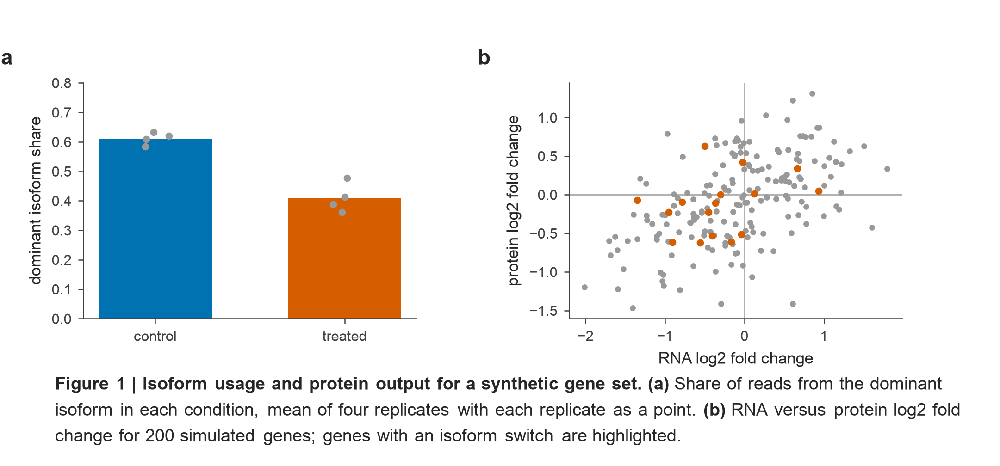
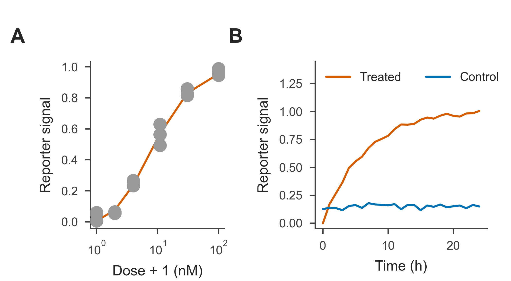
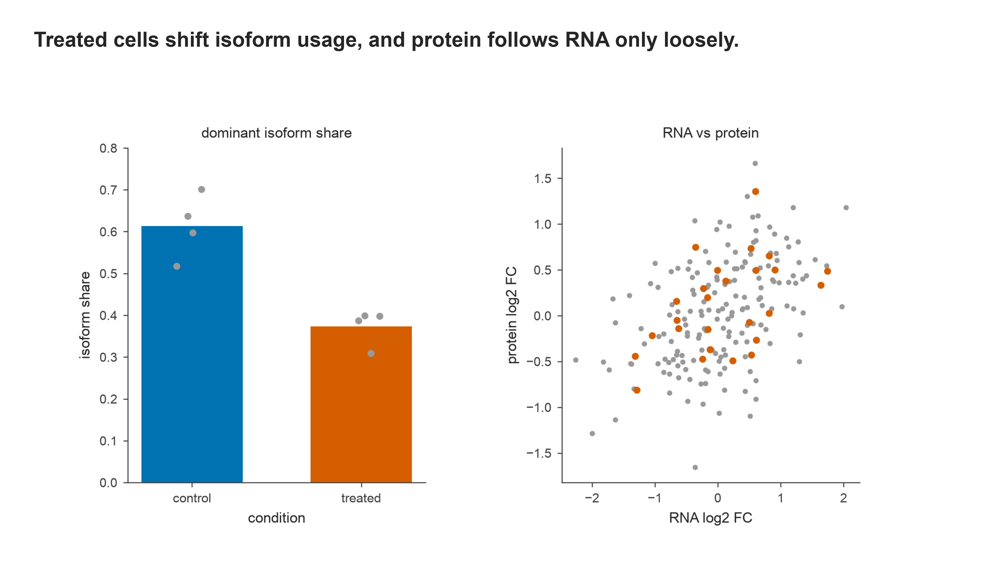

# figproof

figproof is a matplotlib toolkit for publication figures. Every color comes from one token file, the page is sized for its audience, and each figure is checked before it is written. The checks cover the minimum type and stroke size on the printed page, overlapping text and labels, artists that fall outside the canvas, and colors that carry two different meanings in the same figure. A figure that fails a check is not saved.

## Install

```bash
pip install git+https://github.com/k-roy/figproof
pip install adjustText colorspacious        # optional: label repulsion and color-vision checks
```

Python 3.9 or later with matplotlib 3.7 or later. Arial is the preferred font, and matplotlib falls back to its default sans-serif font if Arial is not installed.

## Quick start

```bash
python examples/isoform_example.py          # writes examples/out/isoform_example_fig.png
```



```python
import figproof as fp
from figproof import tokens as T

fig = fp.figure("collab", width="double", body_height=2.3, legend="Figure 1 | Title. (a) First panel. (b) Second panel.")
ax = fig.fp.axes(0.6, 0.3, 2.4, 1.7, label="(a)")      # inches from the top-left corner of the figure body
ax.bar([0, 1], [0.62, 0.41], color=[T.colour("role.reference"), T.colour("role.focal")])
fp.finish(fig, "my_fig", "out")                          # letters, legend, checks, then save
```

`figure()` measures the page height from the body, the legend and the mode's margins, so the legend never collides with the panels. Place axes in inches with `fig.fp.axes(x, y, w, h)`; panel letters come from the `label` argument. `finish()` raises `figproof.GateError` and writes nothing when a check fails. Pass `strict=False` to write the figure anyway and get the list of problems back.

## Modes

| mode | for | page |
|---|---|---|
| `internal` | lab use | measured page with a provenance footer and a Markdown sidecar; needs `provenance=` |
| `collab` | collaborators | as `internal`, without the footer or sidecar |
| `journal` | a journal submission | a journal column width (55 to 184 mm), at most 170 mm tall, 6 to 7 pt type, strokes 0.6 to 1.5 pt, no minor ticks or grid lines |
| `supplementary` | supplementary figures | at most 180 by 170 mm, every stroke at most 1 pt |
| `slide` | a talk slide | 13.333 by 7.5 in, no panel letters; needs `title=` |
| `abstract` | a graphical abstract | 5.5 in square at 300 dpi, 12 to 16 pt type, one panel |

## Examples

The same plotting code serves a manuscript and a talk. Only the mode, the size and the way each panel is named change. All three scripts use synthetic data and write to `examples/out/`.

### Manuscript panel (`journal` mode)

```bash
python examples/journal_example.py          # PDF + PNG at 89 mm wide, legend in its own .txt
```

```python
fig = fp.figure("journal", width="single", body_height=1.55, legend=LEGEND)
ax = fig.fp.axes(0.62, 0.12, 0.92, 1.15, label="(A)")
```



Journal mode follows the rules that the major journals all accept. Type is set to 7 pt for axis labels and 6 pt for ticks, and `finish()` refuses any text outside 6 to 7 pt, any stroke thicker than 1.5 pt, minor tick marks and grid lines. It warns when plotted symbols are smaller than 6 pt across. Panel letters are 10 pt bold capitals (A, B, C); pass `letters="lower"` to `figure()` for 8 pt bold lowercase (a, b, c) when a journal asks for it.

Build the figure at the width it will print at: a figure reduced to a narrower column shrinks its type below the minimum. The named widths cover the two common journal grids, `"single"` (89 mm), `"onehalf"` (120 mm) and `"double"` (183 mm), and `"third"` (57 mm), `"twothirds"` (121 mm) and `"full"` (184 mm). A width in millimetres such as `"85mm"` also works, and journal mode accepts 55, 57, 85, 87, 89, 114, 120, 121, 174, 178, 183 and 184 mm. Widths of 55, 85, 114 and 174 mm fit every major journal's columns without reduction. The PDF is the submission file; the PNG beside it is written at 600 dpi. The legend is written to `journal_example_fig_journal_legend.txt` for the manuscript file rather than drawn on the figure.

### Talk slide (`slide` mode)

```bash
python examples/slide_example.py            # 13.333 x 7.5 in PNG, an SVG with live text, and the speaker notes
```

```python
fig = fp.figure("slide", width="double", body_height=3.4, legend=LEGEND,
                title="Treated cells shift isoform usage, and protein follows RNA only loosely.")
ax = fig.fp.axes(0.60, 0.35, 2.40, 2.70)
ax.set_title("dominant isoform share")      # panels are named on the slide, never lettered
```



A slide carries a one-sentence claim as its title, and the legend goes to `slide_example_fig_notes.txt` for the speaker notes. Because the audience never sees that legend, `finish()` refuses a slide that has panel letters, a data panel without a name, or no axis labels. Type is 16 pt for axis labels and 14 pt for ticks. For multi-panel slides, `figproof.slides.grid` lays out panels under shared column headers and row labels.

## Colors

Colors are named tokens, never hex literals. `T.colour("role.focal")` returns the hex for one token, and `T.layer("role")` lists a whole layer.

- `role` colors carry the argument of a data panel: `focal` is the condition the figure is about, `reference` is what it is compared against, and `stratum_a`, `stratum_b`, `match` and `control` cover the remaining cases.
- `mark` colors label RNA features: `splice`, `polya` and `mod`.
- `neutral` is the hue-free ramp for text, axes and background data.
- `identity` colors name molecules in schematics (guide, donor, barcode, edit, PAM and others), and `ground` holds tints and backgrounds.

The palette was chosen to stay separable under deuteranopia and protanopia, and in grayscale. The figure check flags a hex that is used with two meanings in one figure.

## Modules

- `figproof.panels`: role-colored bars and points, replicates drawn as points, and the type and stroke floor checks.
- `figproof.points`: two-group scatter plots with an overlap measure.
- `figproof.transcript` and `figproof.schematics`: RNA drawn as molecules, with caps, poly(A) tails, splice sites, lariats and read-end classes.
- `figproof.glyphs` and `figproof.molecules`: a schematic vocabulary for DNA and RNA, Cas9 and guide RNAs, repair intermediates, cells, colonies and plates.
- `figproof.slides`: slide grids and text cards that are sized from their content.
- `figproof/qa/figqa.py` and `figproof/qa/figstyle.py`: the overlap and style checks that `finish()` runs, also usable on their own.

## License

MIT. See `LICENSE`.
